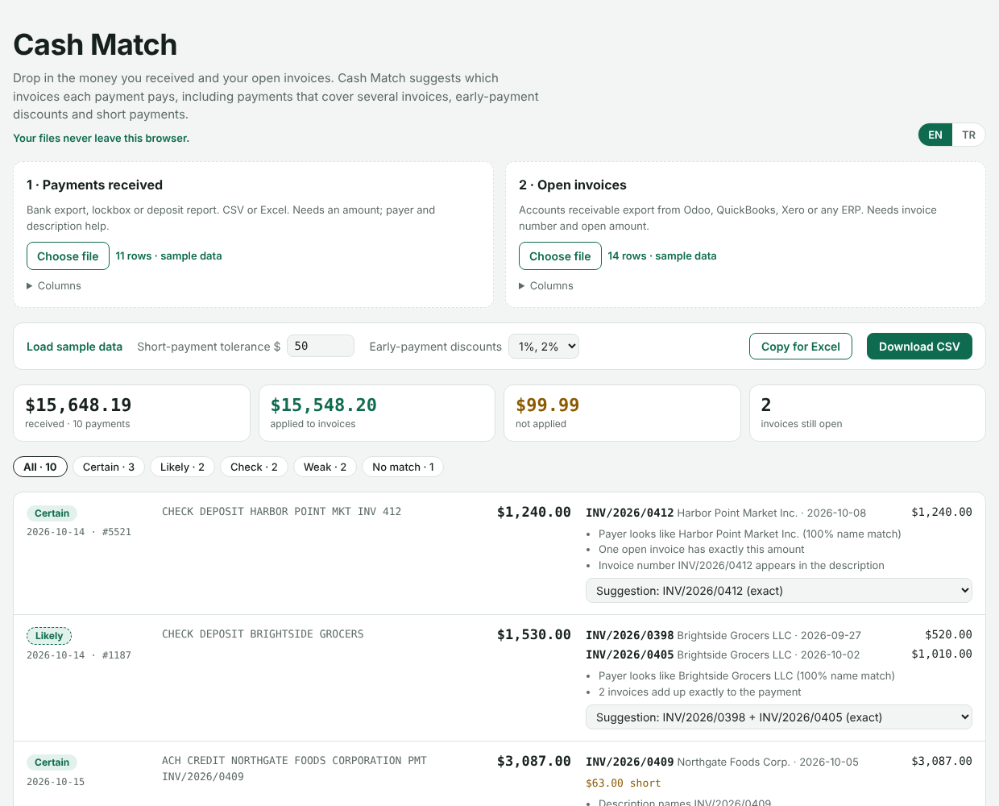

# Cash Match

**Match incoming payments to open invoices: in your browser, in seconds, with the reason for every suggestion.**

**Live:** https://eyildirim61.github.io/cash-match/ (loads with sample data)



## The problem

Every business that sells on credit does *cash application*: money arrives as checks, ACH or wires, and someone has to work out which invoices it pays before recording it. It sounds simple and rarely is:

- The bank line says `CHECK DEPOSIT HARBOR POINT MKT`, while the customer in the ERP is *Harbor Point Market Inc.*
- One check pays three invoices, and nothing on it says which.
- The customer took a 2% early-payment discount, or the wire arrived $25 short after bank fees.
- Two invoices have the same amount.

Large companies buy dedicated software for this. Small and mid-size companies do it by hand in spreadsheets. Cash Match takes the two exports they already have and proposes the matches.

## What it does

1. **Load two files** (CSV or Excel): the payments you received (bank export, lockbox file, deposit report) and your open invoices (an accounts receivable export from Odoo, QuickBooks, Xero, NetSuite, Logo, Mikro…). Columns are recognised automatically and can be changed.
2. **Review the suggestions.** Each payment gets a status, the invoices it pays, the amount applied to each, any difference, and the reasons in plain language. Alternatives are one click away.
3. **Export** the result for Excel or as CSV, then record the payments in your accounting system.

| Status | Meaning |
|---|---|
| **Certain** | The description names the invoice and the amount fits, or name and exact amount agree |
| **Likely** | Exact fit for the customer, e.g. several invoices adding up to the payment |
| **Check** | Plausible, but needs a person: equal amounts, short payments, several possible combinations |
| **Weak** | A guess: partial payment applied to the oldest invoices, or the amount matches another customer |
| **No match** | Nothing fits |

## How the matching works

For every payment Cash Match builds candidate explanations and scores each one:

- **Customer from the description.** Bank lines rarely have a payer column, so the customer's name is looked for inside the description, ignoring bank words (*CHECK, DEPOSIT, ACH, WIRE, PMT*) and understanding abbreviations (*MKT* = market, *ST* = street or saint) and legal suffixes (*LLC, Inc., Ltd. Şti., A.Ş.*). The first word of the name must be present, so *Southgate Foods* does not match *Northgate Foods*.
- **Invoice numbers in the memo.** `PMT INV-2026-0409` matches `INV/2026/0409`. Short forms like `INV 440 444` are used only when the number identifies exactly one open invoice.
- **Several invoices per payment.** A bounded subset-sum search over the customer's open invoices, oldest first, finds every combination that adds up exactly to the payment. If more than one fits, the one with the oldest invoices is suggested and the payment is marked *Check*.
- **Discounts and short payments.** Combinations are also tried with 1% and 2% early-payment discounts, and with a configurable tolerance for payments that arrive a little short (bank fees, small deductions).
- **No invoice used twice.** Payments are assigned in order of confidence; a payment whose only candidates were taken by stronger matches says so.

All amounts are handled as integer cents, so totals are exact. The matching logic is plain functions with no access to the page, covered by tests.

## Privacy

Files are read by the browser and never uploaded. Nothing is stored: only the language and settings are remembered on your device. This matters because payment and receivables data is confidential, and many companies do not allow it to be pasted into online tools or AI chat services.

## Run it locally

No build step and no dependencies (Excel files are read with [SheetJS](https://sheetjs.com), loaded only when you open an .xlsx).

```bash
git clone https://github.com/eyildirim61/cash-match.git
cd cash-match
python3 -m http.server 8000      # then open http://localhost:8000
npm test                          # Node 18+
```

The files in `samples/` are synthetic: fictional companies, designed to show each matching case.

## Limits

- Suggestions, not postings: a person reviews before anything is recorded.
- A number such as `1,234` is read as one thousand two hundred thirty-four (thousands separator). Exports with two decimals (`1,234.00` or `1.234,00`) are never ambiguous.
- Single currency per run.

## Files

| File | Role |
|---|---|
| `src/table.js` | CSV parsing, amounts in any format to cents, dates (US, European, ISO, Excel serials) |
| `src/columns.js` | Header recognition for bank and ERP exports (English and Turkish) |
| `src/names.js` | Company-name normalisation and similarity, invoice references in memos |
| `src/match.js` | Candidate generation, subset-sum search, scoring, conflict-free assignment |
| `src/data.js` | Rows to payment and invoice records |
| `src/app.js` | The page |

## License

MIT
